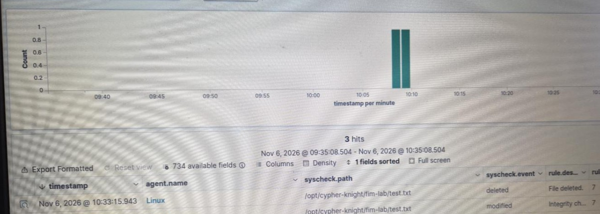
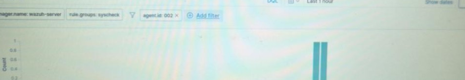
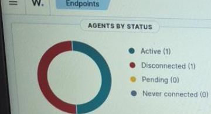

# Wazuh File Integrity Monitoring Lab

## Overview
A self-hosted Wazuh SIEM running on an Ubuntu Server monitored a separate Zorin OS endpoint. This lab verified that Wazuh File Integrity Monitoring (FIM) can detect file creation, modification, and deletion and display corresponding security events centrally.

## Lab architecture
- **Manager:** Ubuntu Server host running Wazuh (private address redacted)
- **Endpoint:** Zorin OS 18.1, x86_64, Wazuh agent 4.14.9
- **Connectivity:** TCP 1514 (agent communication), TCP 1515 (enrollment)
- **Monitored test directory:** `/opt/cypher-knight/fim-lab`

## Configuration
Added the following entry **inside the existing `<syscheck>` block** in `/var/ossec/etc/ossec.conf` on the Zorin endpoint:

```xml
<directories realtime="yes" check_all="yes">/opt/cypher-knight/fim-lab</directories>
```

The existing `<disabled>no</disabled>` setting remained enabled for monitoring. After saving, restarted the agent with `sudo systemctl restart wazuh-agent` and verified `active (running)`.

## Test procedure
In a dedicated lab directory:

```bash
sudo mkdir -p /opt/cypher-knight/fim-lab
sudo chmod 755 /opt/cypher-knight/fim-lab
echo "Cypher Knight FIM baseline" | sudo tee /opt/cypher-knight/fim-lab/test.txt
# Wait for the event to be indexed
echo "SECURITY TEST: File modified" | sudo tee -a /opt/cypher-knight/fim-lab/test.txt
# Verify the modification alert before removing the file
sudo rm /opt/cypher-knight/fim-lab/test.txt
```

## Observed results
| Operation | Wazuh rule ID | Alert level | Result |
| --- | --- | --- | --- |
| Created | 554 | 5 | Detected |
| Modified | 550 | 7 | Detected |
| Deleted | 553 | 7 | Detected |

The dashboard showed all three events for the same monitored test file, confirming the agent-to-manager reporting path.

## Evidence






## Security and privacy
Screenshots were cropped to exclude browser URLs, private IP addresses, terminal usernames, device hostnames, and unrelated application content. No agent keys, passwords, or raw configuration exports are included. Do not commit `/var/ossec/etc/client.keys` or any credential-bearing files.

## Skills demonstrated
Wazuh SIEM administration, Linux endpoint onboarding, file integrity monitoring, security event validation, and alert investigation.
